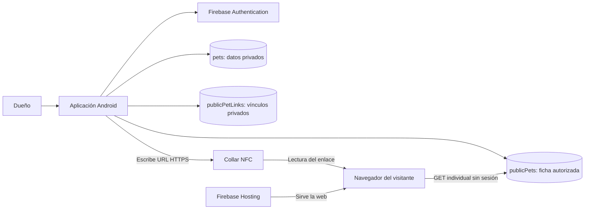

# MyPet

Sistema de identificación de mascotas mediante un collar NFC, una aplicación Android para sus dueños y una ficha pública accesible desde el navegador.

**Sitio web:** [mypet-pip.web.app](https://mypet-pip.web.app/). La página principal presenta una mascota ficticia; las fichas publicadas se consultan mediante su enlace individual.

## ¿Qué es MyPet?

MyPet es un Proyecto de Investigación Personal que propone una solución tecnológica para facilitar la identificación y recuperación de perros perdidos. Un collar con una etiqueta NFC permite acceder a información autorizada de la mascota y, si su dueño lo permite, a un teléfono de contacto.

La persona que encuentra al perro puede leer el collar con un teléfono compatible y abrir su ficha sin instalar MyPet ni iniciar sesión. El dueño utiliza la aplicación Android para administrar los datos privados, publicar la información que desea compartir y programar el collar.

## Características principales

- Registro, inicio y cierre de sesión mediante correo electrónico y contraseña.
- Registro y edición de mascotas, con estados «En casa», «Perdida» y «Encontrada».
- Separación entre los datos privados de la mascota y su ficha pública.
- Publicación de campos revisados por el dueño, con autorización explícita y teléfono de contacto opcional.
- Consulta pública desde una página web adaptable a distintos tamaños de pantalla.
- Apertura y uso compartido del enlace desde Android.
- Programación de etiquetas NFC mediante un registro NDEF URI y verificación posterior por lectura.
- Comprobación de disponibilidad de NFC, capacidad y permiso de escritura de la etiqueta; cancelación, reintento y confirmación antes de reemplazar contenido existente.
- Revocación del enlace público y generación de un identificador diferente al publicar nuevamente.
- Pruebas unitarias, instrumentadas, web y de autorización de Firestore.

## ¿Cómo funciona?

1. **Registrar la mascota.** El dueño crea una cuenta o inicia sesión y añade la información de su mascota en Android.
2. **Publicar la ficha.** En el detalle de la mascota, selecciona **Revisar datos para publicar**, revisa los campos, autoriza los datos y pulsa **Publicar datos revisados**. El teléfono solo se publica si se autoriza expresamente.
3. **Programar el collar.** Una vez disponible el enlace, pulsa **Programar collar NFC** y acerca la etiqueta al teléfono. MyPet escribe la URL y vuelve a leerla; solo confirma el éxito si el contenido coincide.
4. **Consultar la ficha.** Quien encuentra al perro acerca un teléfono compatible al collar y abre el enlace HTTPS. El navegador consulta la ficha pública sin autenticación.
5. **Actualizar o revocar.** El dueño puede volver a publicar los campos revisados o seleccionar **Desactivar enlace**. Una publicación posterior a la revocación requiere reprogramar el collar con el nuevo enlace.

La URL tiene esta estructura; el identificador lo genera Android, no se introduce manualmente:

```text
https://mypet-pip.web.app/?p=IDENTIFICADOR_PUBLICO
```

## Tecnologías utilizadas

| Área | Implementación |
| --- | --- |
| Aplicación Android | Kotlin, Jetpack Compose, Material 3 y Navigation Compose |
| Estado y operaciones NFC | ViewModels, estado observable de Compose y corrutinas |
| Imágenes en Android | Coil |
| Identidad y datos | Firebase Authentication y Cloud Firestore |
| Página pública | HTML, CSS y módulos JavaScript, con consultas Firestore REST |
| Alojamiento | Firebase Hosting |
| Collar | NTAG213 y registros NDEF URI mediante las API nativas de Android |
| Pruebas | JUnit, AndroidX Test, pruebas de Node.js, Chromium y Firestore Emulator |

La configuración versionada utiliza Android Gradle Plugin **9.2.1**, Gradle Wrapper **9.4.1**, complemento Kotlin Compose **2.2.10** y Firebase BoM **33.7.0**. Las versiones se encuentran en [el catálogo de dependencias](gradle/libs.versions.toml).

## Arquitectura general

El repositorio contiene un único módulo Android, `app`, y una web estática independiente. Android organiza sus pantallas en `ui/screens`, el estado y las operaciones en `ui/viewmodel`, los modelos en `data/model` y el acceso NFC en `data/nfc`.



| Colección | Finalidad y acceso |
| --- | --- |
| `pets` | Datos privados asociados a `ownerId`. Cada usuario autenticado accede a sus mascotas. |
| `publicPetLinks` | Relación privada entre el identificador público, la mascota y su dueño. |
| `publicPets` | Copia de los campos autorizados. Solo las fichas activas admiten lectura pública individual; los listados están denegados. |

La publicación y la revocación utilizan transacciones de Firestore. El lector web solicita únicamente `publicPets/{publicId}` mediante REST; no necesita credenciales de administrador ni el SDK Firebase Web.

## Estructura del repositorio

```text
MyPet/
├── app/
│   ├── src/main/java/com/example/mypet/
│   │   ├── MainActivity.kt
│   │   ├── data/model/
│   │   ├── data/nfc/
│   │   └── ui/
│   │       ├── screens/
│   │       ├── theme/
│   │       └── viewmodel/
│   ├── src/main/res/
│   ├── src/test/
│   ├── src/androidTest/
│   ├── build.gradle.kts
│   └── google-services.json
├── web/
├── tests/
├── docs/
├── gradle/
├── gradlew
├── gradlew.bat
├── firebase.json
├── .firebaserc
├── firestore.rules.proposed
└── firestore.publicPets.proposed.rules
```

`firestore.publicPets.proposed.rules` conserva una propuesta histórica. **No es el archivo seleccionado para despliegue.**

## Requisitos para ejecutar el proyecto

- Android Studio con soporte para la versión de Android Gradle Plugin del proyecto.
- **JDK 21** para Gradle; está declarado en [gradle-daemon-jvm.properties](gradle/gradle-daemon-jvm.properties). La compatibilidad Java del código se configura en Java 11 y no sustituye este requisito del entorno de compilación.
- Android SDK con la plataforma **36.1**, utilizada como `compileSdk`. La aplicación tiene `targetSdk 36` y `minSdk 23` —Android 6.0—.
- Acceso a Internet para descargar dependencias y utilizar Firebase.
- Un dispositivo Android o emulador para ejecutar la aplicación. Para escribir el collar se necesita un **teléfono físico con NFC** y una etiqueta compatible y reescribible.
- Para pruebas web y herramientas Firebase: **Node.js 22.23.4** y npm, utilizados en las verificaciones del proyecto. Firebase CLI se ha utilizado en su versión **15.0.0** mediante `npm exec`, sin instalación global.
- Google Chrome para las pruebas de navegador. Python es opcional y permite servir la web localmente.

Los comandos siguientes se ejecutan desde la raíz del repositorio en PowerShell, salvo indicación contraria.

## Configurar y ejecutar Android

1. Abrir la carpeta del repositorio en Android Studio y esperar la sincronización de Gradle.
2. Seleccionar JDK 21 como JDK de Gradle e instalar la plataforma SDK requerida desde SDK Manager.
3. Permitir que Android Studio configure la ruta local del SDK en `local.properties`. Este archivo es específico de cada equipo y está excluido de Git.
4. Revisar la configuración Firebase descrita en la siguiente sección antes de registrar cuentas o crear mascotas. La copia actual apunta a un proyecto real.
5. Seleccionar un dispositivo o emulador y ejecutar el módulo `app` desde Android Studio.

Para compilar el APK de depuración con el Wrapper incluido:

```powershell
.\gradlew.bat assembleDebug
```

El resultado se genera en `app/build/outputs/apk/debug/app-debug.apk`. Los artefactos de compilación están excluidos de Git.

## Configuración de Firebase para desarrolladores

La configuración actual apunta al proyecto **`mypet-pip`** y al dominio **`mypet-pip.web.app`**.

| Archivo | Función |
| --- | --- |
| [app/google-services.json](app/google-services.json) | Configuración de cliente Android consumida por el complemento Google Services. |
| [.firebaserc](.firebaserc) | Selecciona `mypet-pip` como proyecto predeterminado de la CLI. |
| [firebase.json](firebase.json) | Configura Hosting con `web/` y selecciona `firestore.rules.proposed`. |
| [firestore.rules.proposed](firestore.rules.proposed) | Política de seguridad seleccionada para Firestore, pese al sufijo histórico de su nombre. |
| [web/firebase-config.mjs](web/firebase-config.mjs) | Identificador del proyecto utilizado por el lector REST. |

Para utilizar un proyecto Firebase propio, es necesario registrar la aplicación Android con su identificador `com.example.mypet`, obtener su configuración de cliente, habilitar Authentication con correo y contraseña y preparar Cloud Firestore con una política equivalente revisada. Los identificadores de proyecto y el dominio deben permanecer coherentes entre Android, la web y las reglas.

El dominio autorizado está restringido en [PublicPet.kt](app/src/main/java/com/example/mypet/data/model/PublicPet.kt), [NfcTagWriter.kt](app/src/main/java/com/example/mypet/data/nfc/NfcTagWriter.kt) y las reglas. Cambiar únicamente `.firebaserc` no adapta todo el sistema a otro proyecto.

La configuración de cliente Firebase no equivale a una cuenta de servicio Firebase Admin. El repositorio no necesita claves privadas de administrador para el flujo público. El acceso efectivo a los datos depende de las reglas de Firestore.

**Operaciones remotas:** desplegar Hosting sustituye contenido del sitio remoto; desplegar reglas cambia la autorización de acceso a la base de datos remota. Ninguna de estas operaciones es necesaria para compilar Android o abrir la demostración local. Deben revisarse el proyecto de destino y el alcance antes de publicar. La configuración y el procedimiento están documentados en [la guía de Hosting](docs/firebase-hosting.md); la política de datos se describe en [el modelo de datos](docs/database.md).

### Abrir la web localmente

La web no necesita un proceso de empaquetado ni instalar dependencias para servirse:

```powershell
python -m http.server 8000 --bind 127.0.0.1 --directory web
```

Abrir `http://127.0.0.1:8000/` muestra una ficha ficticia. Los parámetros `?p=demo-missing`, `?p=demo-disabled` y `?p=demo-error` permiten observar estados de demostración. Detener el servidor con `Ctrl+C`.

Un identificador real consulta el proyecto Firebase configurado, incluso desde este servidor local. Servir la web localmente no sustituye Firestore por su emulador.

## Ejecución de las pruebas

### Android

```powershell
.\gradlew.bat testDebugUnitTest
.\gradlew.bat connectedDebugAndroidTest
.\gradlew.bat assembleDebug
```

Las pruebas instrumentadas requieren un dispositivo o emulador conectado y disponible mediante ADB. Comprueban, entre otros aspectos, la creación del mensaje NDEF y los estados del flujo NFC; no sustituyen una escritura física sobre el collar.

### Web

Con Node.js disponible:

```powershell
node --test tests/web.test.mjs
node tests/browser.mjs
```

Las pruebas de navegador utilizan respuestas ficticias de Firestore y guardan capturas en una carpeta temporal. El script busca Google Chrome en su ubicación habitual de Windows; `CHROME_BINARY` permite indicar el ejecutable compatible.

### Hosting local

En una terminal, iniciar exclusivamente el emulador de Hosting:

```powershell
npm exec --yes --package=node@22.23.4 --package=firebase-tools@15.0.0 -- firebase emulators:start --only hosting --project mypet-pip --config firebase.json
```

En otra terminal, desde la raíz:

```powershell
node tests/hosting.mjs
```

La configuración utiliza `127.0.0.1:5000`. Esta prueba comprueba rutas, recursos, cabeceras y aislamiento de archivos, y ejecuta también las comprobaciones de navegador. Iniciar el emulador no despliega el sitio.

### Autorización de Firestore

[tests/firestore.mjs](tests/firestore.mjs) carga el archivo actual `firestore.rules.proposed` y prueba propietario, otra cuenta autenticada y visitante anónimo. Incluye consultas, publicación, validación de campos, revocación y rechazo de reutilización del identificador revocado.

La suite requiere un emulador limpio en `127.0.0.1:8088`, con el proyecto ficticio `demo-mypet`. Su configuración es temporal e independiente: `firebase.json` no declara ese puerto de Firestore. Seguir la sección «Pruebas de autorización» de [la preparación del emulador](docs/database.md) antes de ejecutar:

```powershell
node tests/firestore.mjs
```

Estas pruebas escriben datos ficticios en el emulador; no deben adaptarse para ejecutarse contra una base de datos real.

## Integración NFC y compatibilidad

El collar utiliza una etiqueta **NTAG213**, NFC Forum Type 2, con 144 bytes de memoria de usuario. MyPet crea un solo registro mediante `NdefRecord.createUri()` y escribe únicamente la URL HTTPS de la ficha. Para el identificador habitual de 32 caracteres, el mensaje NDEF ocupa 58 bytes; además, se comprueba la capacidad comunicada por cada etiqueta.

La implementación:

- Requiere una etiqueta ya compatible con NDEF; no formatea etiquetas automáticamente.
- Comprueba escritura permitida y capacidad antes de modificar el contenido.
- Solicita confirmación si existe contenido diferente y vincula la autorización a la misma etiqueta.
- Lee el contenido después de escribir y compara el mensaje con el esperado.
- Evita operaciones simultáneas y cancela la detección al abandonar la pantalla o pausar la aplicación.
- No bloquea permanentemente la etiqueta ni activa protección de escritura.

Para probarla, publicar una ficha, abrir su enlace, pulsar **Programar collar NFC** y mantener el collar junto a la antena del teléfono hasta recibir la confirmación. Después, leerlo con otro teléfono compatible y comprobar la mascota mostrada. La posición de la antena y el comportamiento de apertura dependen del dispositivo.

Si el enlace ya está grabado y coincide, MyPet lo verifica sin repetir la escritura. Para comprobar la reescritura física se necesita programar un enlace diferente de otra mascota de prueba. Una interrupción durante la operación puede dejar el enlace escrito sin que se haya completado la verificación; el reintento permite comprobar su estado.

## Seguridad y privacidad

- La etiqueta almacena un enlace, no los datos privados de la mascota o de su dueño.
- Los documentos privados se autorizan por `ownerId`; la ficha pública contiene únicamente los campos permitidos por las reglas.
- El dueño debe revisar el texto y las fotografías: la validación de campos no puede detectar todos los datos personales incluidos dentro de un texto libre o una imagen.
- Cualquier persona que obtenga un enlace activo puede consultar su contenido público. El identificador aleatorio dificulta adivinarlo, pero no es una contraseña ni impide copiarlo.
- La web no permite listar fichas mediante las reglas actuales. Los enlaces inexistentes, revocados o denegados muestran el mismo aviso público de indisponibilidad.
- Revocar impide nuevas consultas autorizadas al enlace anterior; no elimina copias o capturas que otras personas ya hayan guardado.
- Los archivos locales, claves de firma, secretos, cuentas de servicio y artefactos de compilación se excluyen mediante `.gitignore`. Antes de cada commit debe revisarse también lo que ya está versionado.
- No deben incorporarse contraseñas, tokens, claves privadas ni datos personales reales a ejemplos, pruebas o documentación.

## Estado actual y limitaciones conocidas

El proyecto incluye los flujos Android de gestión y publicación, la web pública, la revocación y la integración de escritura NFC. Hosting y las reglas se publicaron previamente en `mypet-pip`; la disponibilidad remota depende de la configuración vigente del servicio. La apertura de una ficha real desde Firestore se verificó en una etapa anterior.

Las verificaciones anteriores incluyen compilación de depuración, pruebas unitarias e instrumentadas Android, pruebas web y autorización en Firestore Emulator. Este README no implica que se hayan repetido esas pruebas al editar la documentación.

Limitaciones actuales:

- La escritura y reescritura desde MyPet necesitan validación física con el teléfono y el NTAG213. La lectura de un enlace grabado manualmente fue comprobada previamente; ese resultado no demuestra la escritura desde la aplicación.
- La consulta pública de fichas reales necesita Internet. La etiqueta no contiene una copia de la ficha.
- Un teléfono sin NFC puede administrar mascotas, pero no programar el collar.
- Los cambios privados no actualizan automáticamente la copia pública: deben revisarse y publicarse de nuevo.
- No hay eliminación de mascotas implementada; las reglas la deniegan.
- La foto pública se indica mediante una URL HTTPS; no existe un flujo de carga de fotografías a Firebase Storage.
- Algunas guías de `docs/` conservan referencias a etapas anteriores. Para identificar el archivo de reglas activo debe consultarse `firebase.json`; la propuesta histórica no debe desplegarse por error.

## Documentación y licencia

- [Arquitectura](docs/architecture.md)
- [Modelo de datos y autorización](docs/database.md)
- [Configuración y pruebas de Hosting](docs/firebase-hosting.md)
- [Notas técnicas de NFC](docs/nfc-integration.md)
- [Lista de comprobación para demostraciones](docs/demo-checklist.md)

No se ha especificado una licencia general para MyPet. Los componentes de terceros incluidos conservan sus propios avisos y condiciones; estos no constituyen una licencia para el proyecto completo.
